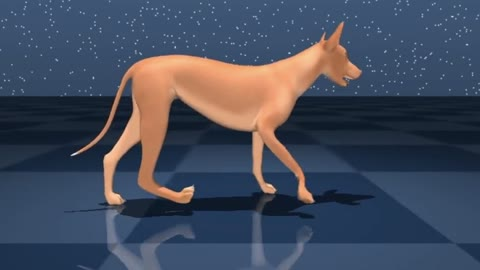
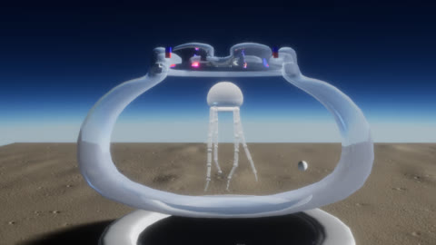
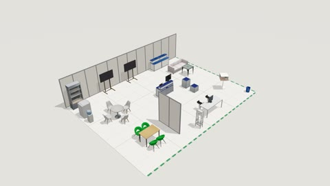
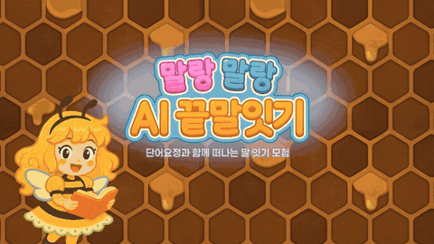

  

<b>현실의 움직임을 <a href="https://wri0raan.github.io/JURAN/">가상으로 옮기고,</a> 다시 현실로 돌려줍니다</b> 
화면 너머의 세계가 진짜처럼 느껴지려면 무엇이 필요할까. 그 질문을 따라 그래픽스와 시뮬레이션, 비전을 공부하고 있습니다.

### 진행 중 Now

 반려견 보행 물리 시뮬레이션 졸업논문 / 쿼레이트 CoSpace 1인 개발

- **물리 시뮬레이션** 몸 모델 · 보행 · 군중
- **컴퓨터 비전** 동작 분석 · 자세 추정 · 트래킹
- **컴퓨터 그래픽스** 캐릭터 · 3D 시각화 · 메쉬
- **XR · 디지털 트윈** 전시 인터랙션 · 공간 시각화

 

<table>
<tr>
<td align="center" width="25%"><h3>8편</h3>논문 · 발표 제1저자 · 단독 4편</td>
<td align="center" width="25%"><h3>8회</h3>수상 HCI Korea · KCGS · 학술연구 우수상 외</td>
<td align="center" width="25%"><h3>2곳</h3>국립 기관 전시 국립중앙박물관 · 국립과천과학관</td>
<td align="center" width="25%"><h3>2회</h3>SIGGRAPH Asia SV 선발 2022 대구 · 2024 도쿄</td>
</tr>
</table>

### 연구 · 작업 Research

<table>
<tr>
<td width="33%" valign="top"> 2026 – 진행 중 · 졸업논문 <b>영상으로 보정한 반려견 물리 모델과 슬개골 탈구 보행</b> 물리 시뮬레이션 · 생체역학 · 궤적 최적화</td>
<td width="33%" valign="top"> 2024 · HCI 창의상 우수상 · 제1저자 <b>XR 테이크아웃 카페</b> XR · 생성형 AI · 음성 인터랙션</td>
<td width="33%" valign="top"> 2022 · KCGS 우수발표상 · 논문지 게재 <b>외부 자력으로 움직이는 촉수 애니메트로닉스</b> PID 제어 · 전자석 · 시뮬레이션</td>
</tr>
<tr>
<td width="33%" valign="top"> 2025 · KCGS 2025 포스터 <b>군중 시뮬레이션 연구</b> 군중 시뮬레이션 · 안전 · 정서 확산</td>
<td width="33%" valign="top"> 2025 · 국립중앙박물관 · 국립과천과학관 <b>AI 한의사와 혈자리 체험</b> Unity · MediaPipe · 트래킹 · 전시</td>
<td width="33%" valign="top"> 2026 – · 쿼레이트 1인 개발 <b>CoSpace 공간 배치 시각화</b> 3D 시각화 · 디지털 트윈 · 웹</td>
</tr>
</table>

### 게임 · 프로젝트 Games & projects

<table>
<tr>
<td width="33%" valign="top"> 2025 · 디지털콘텐츠 이노베이션 페스티벌 우수상 <b>Code:Black</b> · <a href="https://wri0raan.github.io/JURAN/projects/code-black.html#play">▶ 플레이</a> · <a href="https://github.com/wri0raan/CodeBlack">코드</a> C++ · SDL2 · 상태기계 · 보스 AI</td>
<td width="33%" valign="top"> 2025 · 학술연구 우수상 · 단독 개발 <b>AI와 끝말잇기</b> Unity · GPT-4 · FastAPI · TTS</td>
<td width="33%" valign="top"> 2024 – 2025 · LUL 창립작 · 팀장 <b>산군</b> · <a href="https://wri0raan.github.io/JURAN/projects/sangun.html#play">▶ 플레이</a> Unity · C# · FSM · 리더십</td>
</tr>
</table>

### 도구 Tools

<table>
<tr><td><b>언어</b></td><td>

   

</td></tr>
<tr><td><b>시뮬레이션 · 그래픽스</b></td><td>

     

</td></tr>
<tr><td><b>비전 · AI</b></td><td>

    

</td></tr>
<tr><td><b>3D · 콘텐츠</b></td><td>

   

</td></tr>
</table>

더 많은 기록과 영상, 웹에서 바로 해 볼 수 있는 게임은 <a href="https://wri0raan.github.io/JURAN/">wri0raan.github.io/JURAN</a>에 있습니다.

